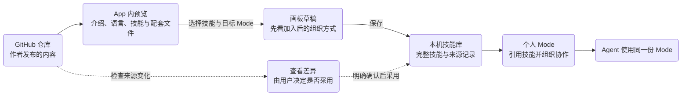
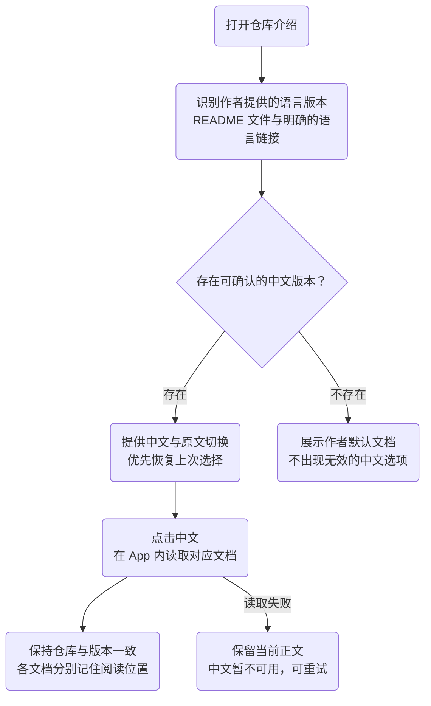
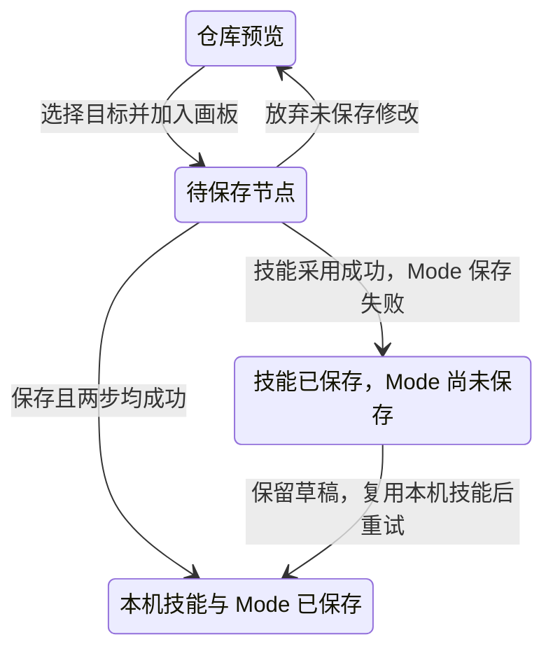
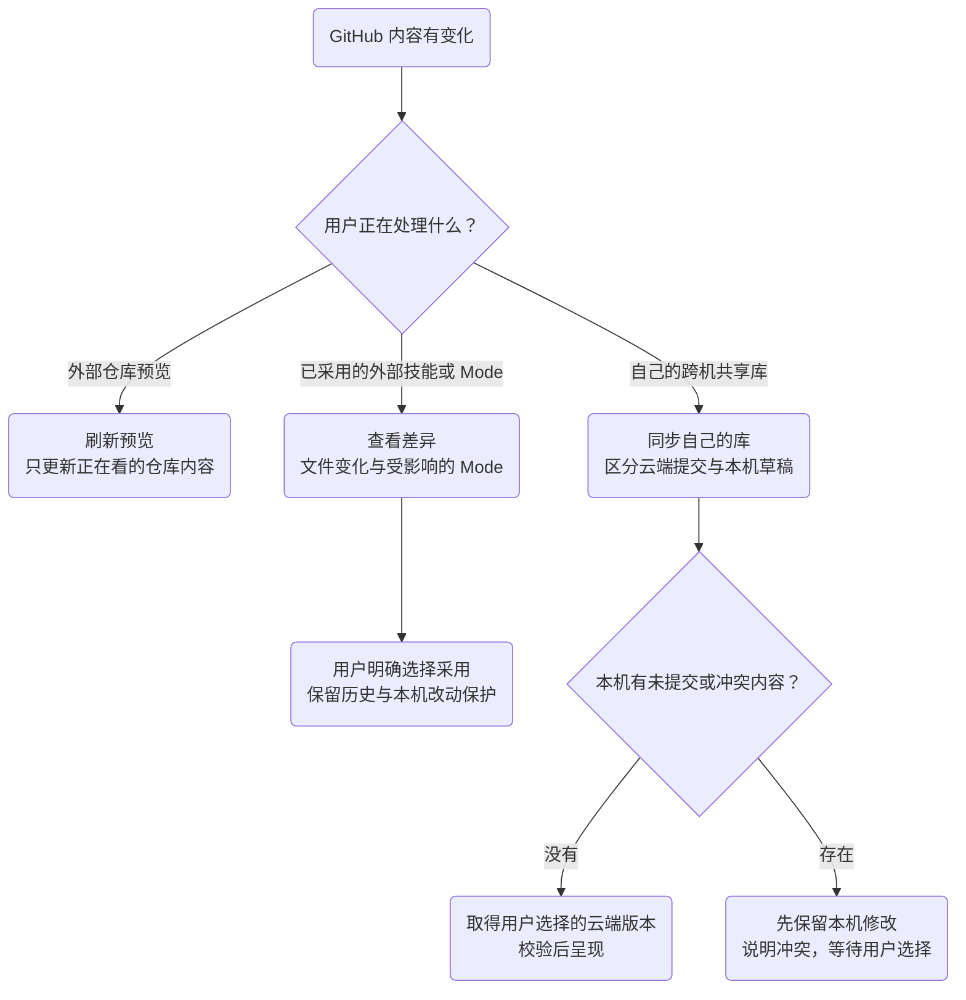

# 技能阅读、来源区分与加入 Mode：产品方案

2026-10-23（America/New_York）。状态：**用户已确认，按分批验收实施**；执行记录见[Windows 适配与产品体验收敛](2026-10-23-Windows适配与产品体验收敛.md)。

本方案回答：用户正在看哪份内容，如何在 App 内读懂它，如何把它纳入自己的 Mode，以及更新会改变什么。保留 Mac 现有视觉与 Mode 画板；实施使用隔离样例，不修改真实 Skill、Mode 或账号，最终发布须先完成验收。

事实基线：Harness `21e386f`。下文“当前”指本次静态代码核对，不等于新版本 Windows 桌面已完成体验验收。项目交付状态仍以[架构总览 View 9](../asl-architecture-views.md#view-9--当前项目状态)为准；此文件是拟议体验与实施计划，不是第二份项目状态真源。

## 一、先用一个例子讲清楚

用户打开 GitHub 上的“公司研究技能”，切换作者提供的中文说明，阅读正文和资料。确认有用后，将它加入自己的 Investment Desk。

此后，这项技能在产品里应表达为：

- **保存位置：本机技能库**；断网也能阅读和使用已保存的完整内容。
- **最初来源：GitHub · 作者／仓库**；可以查看当时采用的版本和现在的来源版本。
- **使用情况：Investment Desk**；从这里能回到实际使用它的 Mode 和节点。

因此，“来自 GitHub”和“已保存在本机”同时成立。一个标签说明不了这两个事实。下载到 App 的预览缓存，也不等于用户已经把技能收入自己的库。

## 二、“GitHub 配置到本机”具体分为四件事

界面不再用笼统的“配置”覆盖以下不同结果。

| 用户实际在做什么 | 建议操作名与结果 | 内容归属及后续更新 |
| --- | --- | --- |
| 只想看看公开仓库 | **预览仓库**；在 App 内阅读，保留入口与阅读位置 | 看到 GitHub 某个版本；缓存服务于阅读，不进入个人技能库，不修改 Mode |
| 想采用外部技能或现成 Mode | **加入 Mode**／**保存到技能库**；预览具体内容与目标位置，确认后保存完整本机内容 | 用户使用本机采用版本，保留外部来源；外部仓库更新由用户另行比较、采用 |
| 在 Windows 和 Mac 维护自己的同一个库 | **打开本机库**，详情中显示其关联 GitHub 仓库；同步时明确拉取或发布的方向 | GitHub 已提交版本是两台电脑共享的基线；本机未提交修改是草稿，拉取不覆盖草稿，发布需要明确操作；这不等于已实现一键同步 |
| 想在 Codex、Claude Code 或 DeepSeek 中使用 | **在 Agent 使用**；选择目标应用与实际作用范围 | 为目标应用配置入口，继续指向可追溯的本机内容；不把它当作又复制一个独立技能库，也不把“配置完成”写成“已经实际使用成功” |

第一种不要求安装 Agent。第二种不自动上传 GitHub。第三种的共享仓库，与第二种技能的外部作者仓库可以完全不同。第四种不是账号登录，也不是让另一个 Agent 代替当前应用执行任务。

**边界例子：**从 `作者A／研究工具` 采用一个技能，存入自己的 `我的技能库`，再将自己的库发布到 `我的账号／agent-skill-library`。用户自己的仓库是跨机协作基线，`作者A／研究工具` 仍是该技能的外部来源；两者不能合并成一个“云端地址”。

## 三、页面怎样表达这些区别

### 3.1 三个信息，各自只回答一个问题

| 用户的问题 | 默认呈现 | 需要时展开的细节 |
| --- | --- | --- |
| 我现在看的是哪一份？ | 页面标题旁显示 **GitHub 预览** 或 **本机**；本机未保存的编辑用现有未保存提示 | 本机目录，或当前预览版本、读取时间 |
| 它来自哪里？ | 名称下方一行 **来自 作者／仓库**；没有可靠来源时写 **本机导入** | 原始地址、仓库内路径、采用版本、采用日期；不凭名称推断作者 |
| 它被用在哪里？ | **用于 2 个 Mode**；点击展开实际名称 | 跳转到对应 Mode 的节点；预览对象尚未采用时，不把“来源中的 Mode”算作本机使用记录 |

主页面不堆满版本号、目录、校验结果。来源与使用情况是不同信息；“有更新”只在确有检查依据时呈现。

本机 Skill 可以用于多个 Mode，Mode 只引用一份库内技能；不为每个 Mode 再复制一份正文。一个 Mode 也可以使用来自多个仓库的技能，不把 Mode 的整体来源套到所有成员上。

### 3.2 侧边栏：本机可用内容与仓库预览分清

- **本机技能库**：日常工作入口，下面是自己的 Modes。打开后展示本机版本。
- **GitHub 预览**：保存过入口的外部仓库，下面是介绍、技能、仓库自带的 Modes。打开后展示仓库版本。
- 如果一个本机库明确关联同一个 GitHub 仓库，且本机路径唯一，可在该库下提供 **GitHub 版本** 对照入口，减少同名顶级项。两个视图保留清楚的“本机／GitHub 预览”标记。
- 仅仅从某仓库采用过一项技能，不把整个外部仓库变成“我的库的 GitHub 版本”。
- 多个真实本机目录指向同一个仓库时，显示路径末段辅助区分；不按同名自动合并，不跳到其他库，不自动删除目录。
- 连接入口与阅读记录独立于可淘汰的内容缓存。重开可重新取内容，入口不能因为缓存失效消失。超过 50 项沿用折叠入口，不截断记录。

## 四、直接阅读：用户点进去具体能看什么

### 4.1 仓库介绍

粘贴链接后在当前 App 打开：仓库名与来源、作者 README，以及清楚可达的技能列表。先呈现能读的介绍，再补齐技能识别结果；介绍与技能最终对齐到同一个仓库版本，不能混用两次更新的内容。

README 的原有标题、目录、图片、表格、代码块和 Mermaid 正常呈现。没有 README 时直接展示能找到的技能和“仓库没有提供介绍”，不伪造摘要，不用空白页或自动跳转 GitHub 代替。

### 4.2 技能详情

点击技能后阅读该技能的完整 `SKILL.md`；配套文件按作者目录组织，可查看说明、脚本与资料。脚本以可读代码呈现，浏览不会执行。支持的图片或文件类型原位预览；其他类型显示文件名和明确的打开操作，不假装已经支持所有格式。

仓库 README 属于仓库介绍，不能当作每个技能的说明；技能没有配套文件时不展示空文件区。仓库预览保持只读。采用到本机后才进入自己的管理路径；本轮仍不修改真实技能内容。

### 4.3 链接行为

| 点击的内容 | 具体结果 |
| --- | --- |
| 同一仓库、同一版本中的中文／英文 Markdown 或使用文档 | App 内打开；能返回上一文档与原阅读位置 |
| 文档内目录或章节链接 | 在当前阅读器定位到该章节 |
| 同仓库图片 | 根据该文档的相对位置呈现；图片不可用不影响正文阅读 |
| 另一个分支、标签或版本的文档 | 明确切换到对应仓库版本后读取；不能悄悄拿当前快照的同名文件代替 |
| 其他站点或未支持的 GitHub 页面 | 由用户点击后外部打开，保留当前阅读位置；不把这条外链算成 App 内阅读已支持 |

返回仓库、技能列表、Mode 后，筛选、选中项和滚动位置分别保留。网络刷新尽量留住已显示的内容；首次读取失败展示重试，不把“读取失败”写成“仓库没有技能”。

## 五、语言切换：切换作者文档，不改写内容

目标：用户点“中文”，看到作者提供的中文版本，仍在原仓库阅读路径中。

具体规则：

1. 识别常见语言文件名，以及作者明确标识的语言入口；支持中文在 `docs/zh/` 等子目录。不能把任意中文链接都当作 README 的中文版本，拿不准就保留普通文档链接。
2. 同一仓库重新打开优先恢复上次语言。首次进入时，有明确对应版本则按 App 界面语言选取，否则使用作者默认 README。普通 README 也可能本来就是中文，不强行标成英文。
3. 只有一个版本时不增加语言控件；多个版本使用轻量切换，位置靠近介绍标题，不另开语言配置页。
4. 切换语言不改变技能选择、目标 Mode、当前仓库版本，也不翻译或修改本机 Skill。没有作者中文版本时如实呈现，自动翻译不在本轮范围。
5. 同一版本的中文文档离线已缓存时可读，并标注“上次读取”；未缓存时保留当前正文并说明暂时无法读取，不能假称中文不存在。

## 六、从 GitHub 加入 Mode：逐步操作与落地结果

### 6.1 推荐路径

1. 用户在仓库或技能详情选择 **加入 Mode**，选当前库中的 Mode，或新建同级 Mode；目标库已有明确上下文时不重复询问。
2. 进入既有 Mode 画板，来源技能列表保留本次仓库；逐项阅读、选择、拖入。新技能成为 **待保存节点**，可调整位置、连接与说明。默认不把整库自动连成流程。
3. 点击现有保存操作时，采用缺少的完整技能包，再保存 Mode 的成员和图。沿用现有 CLI 两步能力，不承诺跨库大事务，不新建一套导入引擎。
4. 完成后停在目标 Mode，保留选中新节点；一句话提示 **已加入 Investment Desk**，可进入演进查看此次组织变化。来源仍可从节点详情查看。

**已批准并在开发版接入：选择、拖入阶段只维护现有画板草稿；对已有库的新增技能采用延后到最终保存。** 原先部分入口会在打开画板或拖入时先保存技能，已用隔离失败用例收敛；最终 Windows 包验收及交付状态见执行记录，不把开发通过称为已经安装。

两步保存出现部分成功时，准确提示 **技能已保存到本机库，Mode 尚未保存**，保留画板草稿并提供重试。重试复用已经保存的技能，不重复复制、不自动删除已保存内容。首次创建新库继续复用现有 `mode.create` 的预览及提交路径。

### 6.2 同名技能如何处理

- 同一库、同一实际技能：复用已有本机对象，不重复导入；已在目标 Mode 中时定位现有节点。
- 名字相同、来源不同或内容不同：显示正在预览与本机已有版本的区别，用户明确选择后才能复用本机版本；不能在预览 A 的同时悄悄加入 B。
- 本轮默认保留本机正文。替换或改写已有技能要单独说明文件与影响、取得具体授权；不借“加入 Mode”顺带更新技能。
- 暂不自动为冲突来源发明新 ID、合并正文或创建技能变体。用户可以保留本机版本或取消，进一步冲突管理另行讨论。

本轮实际验收只使用隔离样例，不在真实库执行上述采用、替换或保存操作。

## 七、刷新、更新、同步：每个动词只对应一种后果

| 操作名 | 会改变什么 | 不包含什么 |
| --- | --- | --- |
| 刷新仓库预览 | 预览快照与读取时间 | 不改本机技能或个人 Mode |
| 检查来源更新 | 核对来源是否有新提交 | 有新提交不等于某项技能变了，也不等于应当替换 |
| 查看差异 | 展示实际文件差异、完整技能范围、相关 Mode | 没有共同基线时不声称能自动识别哪段是本机改动 |
| 采用此版本 | 经单独确认后更新选定本机内容，留下记录 | 不改用户没有选中的其他技能；当前这轮不操作真实内容 |
| 同步自己的库 | 明确拉取或发布哪些共享内容 | 不自动上传草稿、账号、秘密与私人归档；尚未完成的同步功能只做方案 |
| 在 Agent 使用 | 配置所选应用的使用入口，呈现实际作用范围 | 不自动发布 GitHub，不宣称已经登录或跑通真实任务 |
| 移除仓库入口 | 从预览连接中移除该仓库，明确取消相应后台读取 | 不删除已采用技能、本机库、Mode 或 GitHub 仓库；重新添加也不自动采用技能 |

“本机”标签按实际阅读位置判断，不能因来源刷新失败变成“未连接”。GitHub 不可用时，已有完整本机技能继续可用。当前来源不明确时显示“来源待核对”，不把本机目录或同名远端猜成已关联来源。

## 八、具体实践：在现有产品上补齐，而不是另建体系

### 8.1 当前代码已具备的基础与未证明的部分

| 本次核对结果 | 对应位置 | 这轮如何处理 |
| --- | --- | --- |
| 仓库 README 可先于完整下载读取；完整快照记录提交；有持久缓存和失效回退 | `desktop/repository-import.cjs` | 复用，核对介绍和技能版本一致；缓存明确区别于正式采用 |
| 同仓库 Markdown 已可在 App 内打开，带文档返回和滚动记录 | `desktop/src/RepositoryMarkdown.jsx`、`repository-links.mjs` | 不是从零开发；补语言版本识别与明确入口。现有链接结果主要是文件路径，跨版本语义需补验，不能直接算已支持 |
| 本机库和 GitHub 来源已有分组，同一关联仓库可显示在本机库下 | `desktop/src/SourceLibrary.jsx`、`presentation.mjs`、`src/asl_harness/local_modes.py` | 复用分组；核对唯一对应与多个目录冲突，不按名称跳转 |
| 仓库技能详情直接读取 `SKILL.md`；组织画板已可读完整配套文件 | `SourceLibrary.jsx`、`ModeWorkspace.jsx`、`SkillCanvas.jsx`、`SkillFiles.jsx` | 核对两条阅读路径的完整性，把配套文件可达性补到仓库阅读，不把只读到正文称为完整包预览 |
| 仓库可进入已有／新建 Mode 画板，同名技能默认保留本机 | `ModeWorkspace.jsx`、`ParadigmEditor.jsx`、`presentation.mjs` | 保留画板，强化来源选择和保存前后反馈；评估将采用延后到保存 |
| 当前 CLI 明确区分技能采用和 Mode 保存，已处理部分成功 | `src/asl_harness/management.py`、`desktop/src/App.jsx` | 延用同一 CLI，不增第二事务或调度层；两步结果在界面说明清楚 |
| Mode 来源提交检查与单技能版本比较已有实现 | `desktop/repository.cjs`、`src/asl_harness/management.py`、`desktop/src/SkillUpdate.jsx` | 检查 Mode 与单项技能的来源覆盖、差异入口和说明，不能把 Mode 提交检查冒充全部技能已检查 |
| 完整两机同步与任意宿主的发现、编辑、真实使用尚不能一概证明 | 架构总览 View 9 及宿主专项视图 | 先核对已有真实路径；不在前端展示“全部支持”或自动同步承诺 |

以上是静态实现事实，不替代本轮 Windows 实际点击、断网、重开、缩放和最终打包后的验证。未执行 WorkBuddy 体验对标，本方案不引用其未经核对的具体功能。

### 8.2 信息使用已有出处

- 本机对象以实际库路径和包身份定位；外部来源以仓库、仓库内路径和已读取提交定位。同名不是同一对象。
- 来源记录继续使用现有 `SOURCE.md`／Mode 上游信息；导入后保留作者已有记录，新增采用事实时不能抹掉原始作者。
- 阅读记录继续使用现有 App 偏好；它只保存语言、位置、选择等，不承载技能正文或 Mode 真源。
- “已加入哪些 Mode”从当前库真实引用计算；“已采用”以实际本机包为准，不按是否点击过按钮或是否有下载缓存判断。
- 不增加每个 Skill 的 sidecar、第二份来源数据库、隐藏提示词主路径或新的同步服务。
- 对外部 Agent，复用当前 `cli.describe`、环境目录读取、技能采用和 Mode 保存接口；呈现同一来源与目标事实。具体应用支持度按实测列出，不把模型平台名称直接当作已接入的 Agent 宿主。

## 九、按用户操作验收

以下是完整验收标准，不表示所有场景均已通过。2026-10-23 开发版已有隔离证据：作者语言切换／重开记忆／明确跨 ref／离线失败保留原文；完整脚本与资料只读；新建及已有 Mode 取消不提前采用、部分保存恢复、同名冲突保留本机。其余来源身份、更新、真实网络、最终 Windows 包及原生 Mac 验收仍按执行记录逐项核对。

| 场景 | 用户应得到的结果 |
| --- | --- |
| 新电脑只有 App，粘贴公开 GitHub 链接 | 能在 App 阅读实际介绍和技能；不要求先配置模型账号或 Agent |
| 仓库有英文 README 与子目录中文说明 | 中文入口可达；点后不跳浏览器，返回及重开保持语言与阅读上下文 |
| 没有中文、中文断链、中文未缓存且断网 | 三者准确区分；不提供假版本，不抹掉已经读到的原文 |
| 先看 README，再等技能列表完成 | 两部分属于同一仓库版本；错误不变成“没有技能” |
| 打开技能的脚本、资料与图片 | 正确属于所选技能，脚本不执行；不能读取到其他库的同名文件 |
| 预览仓库已缓存，但未采用 | 标为 GitHub 预览，个人库文件和 Mode 不变 |
| 将两项技能加入已有 Mode，保存前取消 | 仅放弃画板草稿，不在真实库留下新采用；已有内容不变 |
| 采用成功但 Mode 保存失败 | 如实显示部分成功、保留草稿；重试复用已采用包，不自动回滚删除 |
| 来源 A 的技能与本机 B 同名 | 用户明确选择保留 B 或取消，不在预览 A 后无声加入 B |
| 本机已有技能再次加入已引用它的 Mode | 定位已有节点，不产生重复技能或重复节点 |
| 外部仓库更新后返回自己的 Mode | Mode 保持个人版本；可读到具体差异，未经授权不替换技能 |
| 自己的库关联 GitHub，另外又采用第三方技能 | 能同时识别自己的共享仓库与技能的作者来源，不混为一条来源 |
| 同名库、同仓库两个本机目录、不同 ref、Windows 路径别名 | 保留准确对象；不跳库、不误认为相同版本、不自动删副本 |
| 移除预览入口后重开 | 入口按用户选择消失；已采用内容继续可读，预加载不把入口重新加回来 |
| 暖阅读、冷读取、网络失败、刷新过程中切换页面 | 暖阅读复用内容；冷读取有清楚反馈；错误可原位重试；不显示其他对象的旧正文 |
| Windows 与 Mac、窄窗口和系统缩放 | 同一信息层级与文案；标题、来源、语言入口和主操作清楚可用 |

验证使用隔离库与受控仓库数据，再补真实公开只读仓库阅读；构造数据通过不能冒充真实网络通过。测试、源码界面、最终 Windows 包分别记录，Mac 保留现有成果，未在原生 Mac 核对的项目保留未验收状态。

## 十、确认后的推进顺序与交付物

1. **先确认本方案的对象区分与加入后的体验。** 不从改按钮文案开始；先确保“当前看哪份、保存到哪、是否已进 Mode”表达准确。
2. **走查现有主路径并留图。** 从 README → 中文 → 单项技能配套文件 → 选 Mode → 画板 → 保存 → 来源／演进逐步检查，使用 Mac 已有视觉，不另做一套 Windows 皮肤。
3. **分批修复。** 先阅读及语言，再来源标记与路径身份，再加入／保存及部分成功；每批只改对应现有模块，补相应场景证据。
4. **完成 Windows 渲染与桌面验收。** 与前述已授权适配任务衔接，验证最终软件中的核心路径，不把临时运行时通过当成正式包通过。
5. **验收后按已获授权交付。** 给出具体前后变化、未验收项；验收通过后才提交、同步 GitHub、提供下载并替换桌面。方案完成本身不等于验收完成。

用户已批准的产品取舍：**选择技能、拖入节点时先留在草稿，最终保存才采用到本机并保存 Mode；若保存中途失败，明确保留已成功部分并可重试。** 不为做到表面上的“一步”而隐藏实际落地结果。
